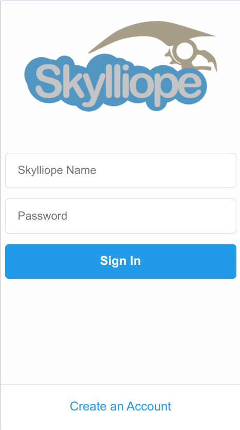
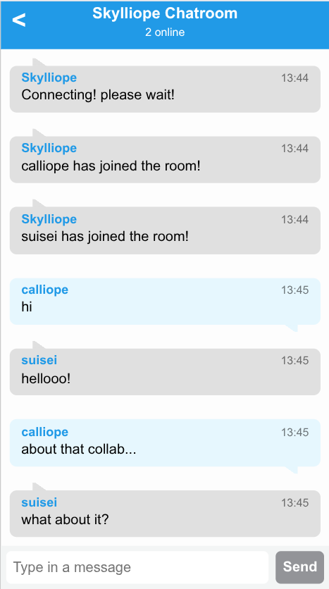

# Skylliope - A chat application with DraconicKit!

This is an example that implements a chat application using DraconicKit's file router and websockets!

It's very bane bones, and is just here to demonstrate basics regarding thread safety, how things are supposed to be initialized and used.

# Screenshots

